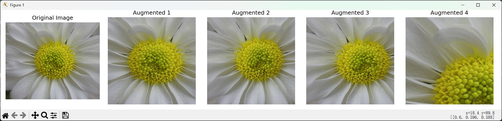
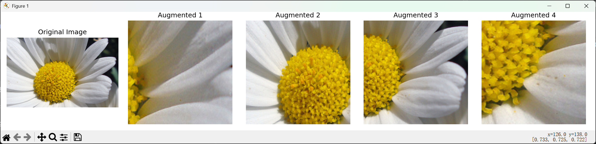
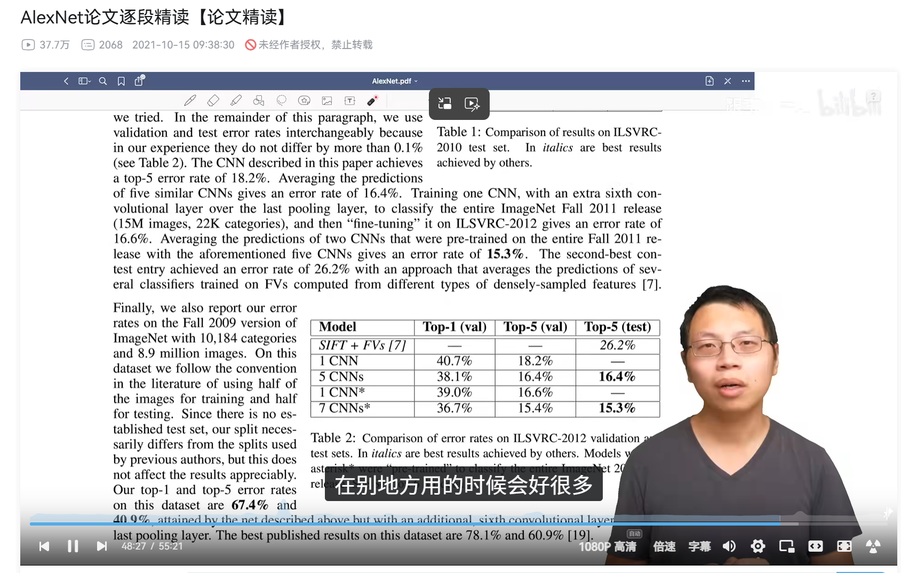
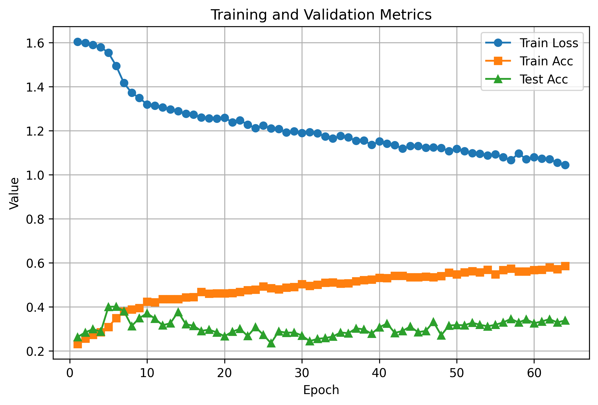
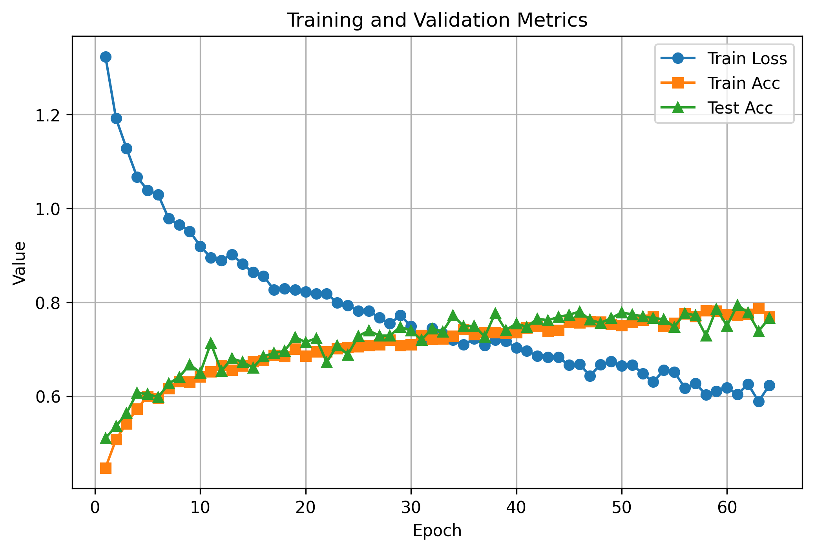
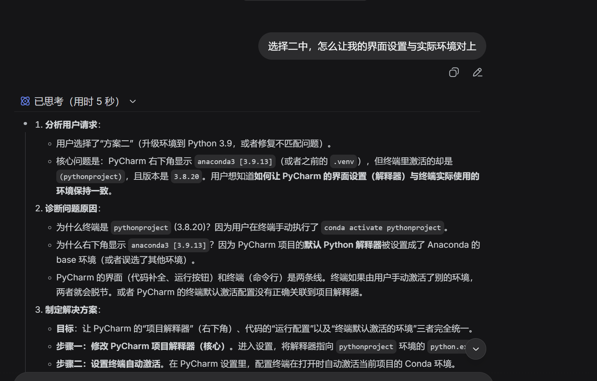
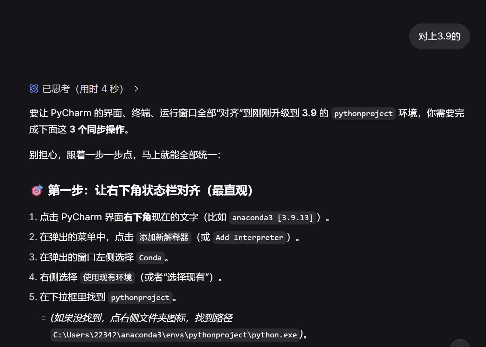
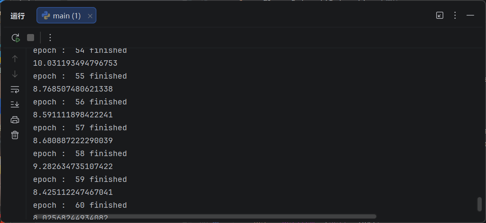
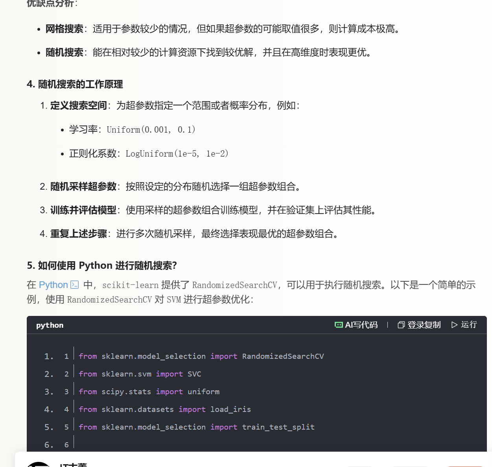

# 花卉小能手

## II-初识卷积神经网络

### 1. 一张RGB三通道彩色图片是如何被处理成可用于训练的数据？张量又是什么？
+ 读取图片为一个三维张量，一般在pytorch需要将维度按通道，高度，宽带的顺序排列，才能使用与pytorch适配。

- 张量是一种多维数组，如果矩阵只能在表示二维的数据，那张量可以通过定义各维度表示更高维的数据。一般在卷积神经网络中会用到四位张量，例如小批量的数据，其四个维度各表示：数据数，通道数，高度，宽度。总而言之，张量可以更方便地帮助我们处理拥有多种‘类型’的数据。

### 2. 一个卷积神经网络分为哪几层？

- 输入层（接受数据）
- 卷积层（对图像进行卷积操作来提取特征）

- 池化层（类似于卷积，通过减少图像的宽高，增加通道数来压缩尺寸，提取核心特征，降低后续计算量）

- 激活层（通常接在卷积层后，通过使用非线性函数引入非线性）

- 全连接层（位于末端，将各通道提取到的高维特征转化为一个的神经网络，在之后进行神经网络相关的操作以将高维数据降维成一维向量，以便于输出分类预测结果）

- 输出层(输出结果)

### 3. 什么是卷积，数学严格意义上的卷积和神经网络中的卷积操作有区别吗？卷积核、步长是什么？

- ml中的卷积是指使用一个权重矩阵，在另一个矩阵上滑动，并在对应位置进行数据与权重的相乘并求和，再按位置输出值形成一个新矩阵，以此会获得一个提取了输入矩阵局部特征的新矩阵。（权重矩阵与输入矩阵也可以是张量）

- 有区别：严格意义上数学的卷积需要经过一次卷积核的翻转，但由于翻转并不会对模型参数上的学习造成实质影响，所以一般在卷积网络中省去了翻转这一步。

- 卷积核是卷积运算时滑动的那个权重矩阵，影响着卷积提取局部特征的识别能力，范围大小

- 步长是指卷积核每次在滑动时移动的距离大小，一般默认是1，即：每次滑动将卷积核向对应方向移动一个单位。步长会影响最终输出矩阵的大小。步长越大，输出矩阵的数据就会越浓缩（因为大小变小 ）

### 4. 池化有哪些类型，其作用分别有什么？感受野是什么？

- 池化有：
     - 最大池化（即选取窗口内的最大值，更好地保留纹理和边缘性特征：数值变化较大的地方）

     - 平局池化（即计算窗口内元素的均值，保留背景信息）

     - 特别的，在最后转化成全连接层时，可以使用全局平均池化来获得不失整体特征的输出值。

- 感受野：对于卷积网络某层中的一个数据而言，所有能影响到该数据值的原始特征数据，所在的范围就是感受野

### 5. 激活层在此的作用？最后卷积神经网络会输出什么？

- 引入非线性，如果没有这一层，整个网络将退化成线性的，不具备拟合非线性函数的能力。

- 输出一串向量，该向量表示了该物品属于对应类别的概率

## III-数据预处理

### 1. 数据集中存在异常或者损坏的图片无法打开（图片默认格式为jpg）；

- 在继承了DataSet的类中使用方法自动清理了损失，异常文件

### 2.划分数据集；

- 代码层面上仅仅划分里训练集，测试集，验证集并没有实现

### 3. 进行数据增强，扩充样本容量（可调库）

- 使用transform对训练集图像进行随机水平翻转，随机放大，调整颜色，进行图像增广。最后转化成tensor并且标准化了。

### 4. 调整图片大小以适应CNN的输入；

- 将图片同一调整为（3，224，224）的tensor格式最后由dataloader打包为小批量的思维张量

- 以下是数据增强的结果对比

## IV-炼丹

### 1 .什么是超参数？如何设定？

- 超参数是模型在训练前设定，一般不随模型训练而改变的参数，它影响机器学习的能力

- 经验设定（参考一些比较有效的模型直接拿来）

- 随数据进行而适当调整（设定验证集，观察模型在验证集的性能进行调整）

- 网格搜索（穷举范围内不同的超参数带入进行训练，选取在验证集上表现最优的那个）

- 随机搜索（类似于网格搜索，不过在取一系列的超参数时将穷举改为了，在给定的参数分布中取值，一般为正态分布）

### 2. 什么是优化器，有哪些类型？

- 根据梯度更新参数的算法

- SGD（随机梯度下降）：基础方法，每次用一小批数据计算梯度并更新。

- 动量法：模拟惯性，加速收敛并减少震荡。

- AdaGrad：记录每个参数的历史梯度平方和自适应调整学习率。

- RMSProp：改进 AdaGrad 的自适应学习率方法。通过考虑最近的梯度大小来自适应地调整每个参数的学习率。

- Adam：融合动量与 RMSProp 的自适应学习率方法。

（ps：我除sgd外，其他只知道大概原理，代码实现还未尝试）

### 3. DataLoader 与 DataSet是什么及其使用？

- DataLoader：一个可以用来将数据集小批量打包的函数，分批次送入模型，以在训练过程中最大化gpu并行运算的强大功能。

- DataSet：一个可以用来创造数据集的抽象类，继承了DataSet的类可以在其中处理图像信息，并且可以很好地适用pytorch框架下的各类函数。不能直接实例化，通常要先创建一个继承了DataSet的类，并实现_len_,__getitem__方法。

### Tips

AlexNet卷积神经网络相比最初的LeNet而言做出了几点重大的转变：

- 使用了ReLu作为激活函数，避免了sigmoid梯度消失的问题，而且很好计算

- 将池化层的池化方法从平均池化改为了最大池化可以保留边缘信息

- 加入了dropout，暂退层的加入可以作为正则化的一种手段，防止过拟合，但是会增长训练时间（大概几倍）。按Alex的想法这可以是模型的gez本质上和L2正则化很像。

- 使用了GPU处理大量并行运算，使得计算时间大幅减少，特别的是，使用两块gpu把模型分成两半来算，（李沐说这玩意代码难写而且没什么大用，虽然现在算力不足时又回归到了这种方法）

- 使用sgdm，可以使模型不容易陷入局部最优，或在一堆极值点旁产生震荡

- 总结：Alex对模型的调整使模型拥有了更强的学习能力，且不易过拟合，其贡献是巨大的，尤其是在激活函数，池化方法上做出的改变

稍微感慨一下，卷积神经网络的发展真的相当迅猛，得益于gpu性能的提升，很多含有大量参数的复杂模型的训练得以成为现实。AlexNet的出现还是在2014年，仅仅是十二年前，而后续出现的各种各样的现代卷积神经网络也是这十年的事如ResNet，NiN，Inception，都是很有想象力且贡献大的模型，

## V-模型的优化与微调（选做）

### 1.相信大家有疑问，我如果一直堆叠网络的层数，岂不是能无限的提高模型的能力？模型层数越多、结构越深，性能就一定越好吗？请自行查阅资料学习。

- 不一定，因为越深的网络越容易发生过拟合，而且由于链式法则，层数多的网络会发生梯度消失

### 2. 2. 学习现代新的网络结构(如ResNet、VGG)，并尝试利用其训练模型，对比两个模型的能力.

- 使用了ResNet再次尝试了对模型进行训练，并将二者模型参数分别存储在了best_model.pth和res_best_model.pth中。两者在训练集损失，训练集准确率，测试集准确率的图像分别如下：

**AlexNet**
**ResNet**
显然，无论是在测试集还是训练集上，ResNet的表现都高于AlexNet

### 3. 模型训练好了该如何使用呢？难道每次使用前都需要重新训练一次？请学习模型的保存与载入方法，将自己的模型保存在本地，自己在网上找到图片后丢给模型分类。

- 两个模型都保存在了scr中，且各配备了预测程序，分别为pre.py,res_pre.py。分别是用alex，res训练出来的，只要将图片塞入to_pre文件夹中，再运行程序就可以实现对夹子里图片的预测

## 学习笔记!

- 配置环境中的一大堆问题，花了三小时，崩溃了。。。。

最初配置的python版本是3.14的最新版，后面要求的是3.9，3.8的版本并且使用conda配置，所以重新弄了，pytorch都得重新下，而且环境也得新建一个。但是使用cmd下载2.5个g的pytorch太慢了，好不容易快下完结果c盘内存不够报错要重下，我下了一个小时啊！。。。后面清理了文件，换了方式用浏览器下，这次很快，十分钟成功了，但是好像对应的python版本不对，我用的是3.8的，而下的是3.9的。我pc里面是有3.9这个版本的，但死活无法激活，cmd里显示，目前版本还是3.8，换了解释器，在激活后也还是（有大佬能解释一下吗）虽然右下角写着解释器是3.9.而且按ds指示重启了终端。后面升级了python，重下了一遍，导入，终于能写代码了，but 程序写完一跑龟速，才发现gpu根本没用上，而我下载的这个pytorch它是不支持我的gpu的于是我需要重下一遍。好在不用改python版本，3.9可以兼容。最后终于开跑了，大概十秒一轮

- 因为d2l看了resnet于是直接照着写了一个，这个残差网络的准确率比原本的高出了10%，在epochs=64训练后准确率能到78%左右，甚至于在我写的预测函数中对四张rose图片预测全对，而alexnet就没有这种准确率

- 了解了随机搜索是什么

- 感觉vgg只是叠块，没有res有突破性提升，不过打包成块再写深一点的神经网络时还是很方便的